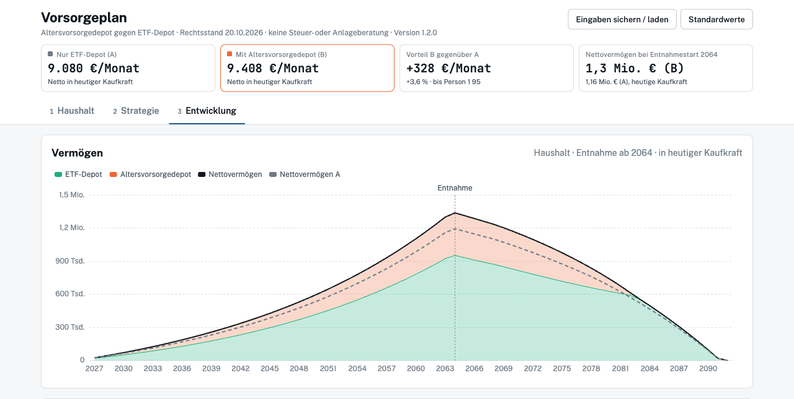

<div align="center">

<h1>Vorsorgeplan</h1>

<h3>ETF-Depot, Altersvorsorgedepot, Basisrente oder private Rentenversicherung? Der Rechner zeigt, was am Ende netto übrig bleibt.</h3>

<p>
  <a href="https://inazr.github.io/vorsorgeplan/"></a>
  <a href="https://github.com/inazr/vorsorgeplan/releases/latest"></a>
</p>

<a href="https://inazr.github.io/vorsorgeplan/">
  <picture>
    <source media="(prefers-color-scheme: dark)" srcset="screenshots/screenshot-dark.png">
    
  </picture>
</a>

<p>
  <a href="https://github.com/inazr/vorsorgeplan/releases/latest"></a>
  <a href="https://github.com/inazr/vorsorgeplan/actions/workflows/pages.yml"></a>
  
  
  
  <a href="LICENSE"></a>
</p>

<p>
  <a href="#was-der-rechner-abbildet"><b>Funktionen</b></a> ·
  <a href="#gesetzliche-werte-und-annahmen"><b>Gesetzliche Werte</b></a> ·
  <a href="#entwicklung"><b>Entwicklung</b></a> ·
  <a href="#releases"><b>Releases</b></a>
</p>

<sub>⚠️ Keine Anlage-, Steuer- oder Rechtsberatung. Modellrechnung mit vereinfachten Annahmen, alle Angaben ohne Gewähr.</sub>

</div>

---

Ein Rechner für die private Altersvorsorge in Deutschland. Ein Sparbudget fließt in bis zu vier Töpfe: ETF-Depot, Altersvorsorgedepot (ab 2027), Basisrente und private Rentenversicherung. Der Rechner vergleicht drei Ergebnisse:

| Ergebnis | Was mit dem Sparbudget passiert |
|---|---|
| **Nur ETF-Depot** | Das ganze Sparbudget fließt in ein normales ETF-Depot. |
| **Deine Aufteilung** | Zuerst in die Vorsorgeprodukte, die du je Person einschaltest, der Rest ins ETF-Depot. |
| **Optimum** | Der Optimierer sucht die Aufteilung und die Auszahlungsoptionen mit dem höchsten Netto, wahlweise bei fester Rendite oder für ein Perzentil aus Monte Carlo. |

Gerechnet wird monatsgenau für einen Haushalt mit zwei Personen, von heute bis zum gewählten Zielalter. Steuern, Kranken- und Pflegeversicherung, gesetzliche Rente und Immobilienkredite sind eingerechnet. Ergebnis ist das höchste monatliche Netto im Ruhestand in Kaufkraft 2026: bis zum Zielalter, als ewige Rente mit realem Kapitalerhalt oder als Reichweite für ein Wunsch-Netto.

> [!TIP]
> Die Seite ist eine einzige HTML-Datei. Sie läuft komplett im Browser, lädt nichts von fremden Servern nach und speichert Eingaben nur lokal. Über „Eingaben sichern / laden“ lassen sie sich als Text auf ein anderes Gerät mitnehmen.

## Was der Rechner abbildet

**Haushalt**
- Eine oder zwei Personen (Person 2 abschaltbar, ihre Eingaben bleiben gespeichert; ohne Person 2 mit Kindern Entlastungsbetrag für Alleinerziehende nach § 24b EStG), angestellt oder selbständig, mit eigener Einkommensentwicklung, verheiratet (Zusammenveranlagung mit Splitting) oder unverheiratet (Einzelveranlagung je Person). Der Splittingvorteil der Erwerbsphase ist nicht eingerechnet (festes Sparbudget, die Lohnsteuer wirkt nicht auf die Sparrate); unverheiratet kann deshalb ein höheres Netto erscheinen.
- Gesetzliche Rente über Entgeltpunkte oder die Prognose der Renteninformation, mit Abschlag bzw. Zuschlag bei früherem oder späterem Rentenbeginn
- Kindererziehungszeiten: 36 Monate je Kind ab dem Monat nach der Geburt, ab dem Stand der Renteninfo als zusätzliche Entgeltpunkte (im EP-Modus mit Kappung an der Beitragsbemessungsgrenze, im Prognose-Modus ohne), zuordenbar zu einem Elternteil. Im EP-Modus kommen Beitrags-EP zwischen Stand der Renteninfo und Rechnungsbeginn dazu (Einkommen ab 2026 fortgeschrieben)
- Krankenversicherung im Alter: KVdR mit automatischer Prüfung der 9/10-Regel, freiwillig gesetzlich oder privat
- Beliebig viele Kinder mit Kindergeld, Kinderfreibetrag, Kinderzulage und Pflegeversicherungs-Abschlag, jeweils monatsgenau ab Geburt; unverheiratet je Elternteil halber Kinderfreibetrag und in der Günstigerprüfung halbes Kindergeld (§ 31 S. 4 EStG)
- Sparbudget mit jährlicher Steigerung, beliebig viele Annuitätendarlehen mit Zinsbindung, Sondertilgung, Anschlussfinanzierung oder Ablösung aus dem Depot

**Anlage**
- Altersvorsorgedepot je Person: Grundzulage, Kinderzulage, Sonderausgabenabzug mit Günstigerprüfung, ungeförderte Zusatzbeiträge, Auszahlungsplan, Einmalauszahlung bis 30 %
- Basisrente je Person: Sonderausgabenabzug bis zum Höchstbetrag (gemeinsam für Ehepaare, abzüglich Beiträge zur gesetzlichen Rente), lebenslange Rente mit Besteuerungsanteil
- Private Rentenversicherung (fondsgebunden) je Person: lebenslange Rente mit Ertragsanteil, Kapitalauszahlung oder Teilkapital mit Hälftelung und 15 % Teilfreistellung
- Kosten von Basisrente und privater Rentenversicherung wie im Produktinformationsblatt: Abschluss- und Vertriebskosten, Verwaltungskosten auf Beiträge, fest und auf das Kapital, Fondskosten, Kosten der Rentenphase, Rentenfaktor. Vorlagen für Provisions- und Nettotarif, Effektivkosten zum Abgleich mit dem PIB
- Steuererstattungen (§ 10a, Basisrente) fließen wahlweise ins Produkt, ins ETF-Depot oder in den Konsum
- ETF-Depot je Person mit bis zu fünf gestaffelten Sparplänen, FIFO je Fonds, Vorabpauschale, Teilfreistellung, Ausschüttungen, Freistellungsauftrag und Verlustverrechnung (bei Ehepaaren gemeinsam); die Sparrate wird nach einstellbarem Anteil aufgeteilt, Verkäufe nach Depotwert

**Entnahme im Ruhestand**
- Beginnt im Monat, in dem beide in Rente sind; Rente und Auszahlungen aus dem Altersvorsorgedepot starten jeweils im Monat nach dem Geburtstag
- Drei Strategien: höchstes gleichbleibendes Netto bis zum Zielalter, ewige Rente (das Nettovermögen bleibt real erhalten) oder Reichweite für ein vorgegebenes Wunsch-Netto

**Auswertung**
- Kennzahlen für nur ETF, deine Aufteilung und das Optimum, Aufteilung nach Personen, Charts zu Vermögen, Fonds, Vorsorgeprodukten, Sparraten, Einkommen und Abzügen mit Summen im Tooltip, Rendite je Anlage als interner Zinsfuß (IRR) nach Steuern und KV
- Alle Werte wahlweise in Kaufkraft 2026 oder nominal, für den Haushalt oder je Person
- Optimierer für die Aufteilung des Budgets: schnell bei fester Rendite oder per Monte Carlo auf das 10-, 25- oder 50-%-Perzentil
- Monte-Carlo-Simulation mit zufälligen Renditen und Inflation (Perzentile 10 bis 90 %)
- Break-even-Zins für die Anschlussfinanzierung
- Jahrestabelle

## Gesetzliche Werte und Annahmen

| Bereich | Stand im Rechner | Status |
|---|---|---|
| Einkommensteuer | Tarif 2026, Entwurf 2027/2028, danach mit Inflation fortgeschrieben (abschaltbar); Splitting bei Zusammenveranlagung, sonst Grundtarif und halbe Soli-Freigrenze je Person | Gesetz / Entwurf / Annahme |
| Regelaltersgrenze | nach Jahrgang (§ 235 SGB VI): 1947–1958 ab 65 Jahren 1 Monat steigend, 1959–1963 je 2 Monate, ab 1964 67 Jahre; Abschlag 0,3 %, Zuschlag 0,5 % je Monat | Gesetz |
| Altersentlastungsbetrag | § 24a EStG: ab dem Jahr nach dem 64. Geburtstag auf Arbeitslohn/Gewinn, nicht auf Renten; Jahrgang 1961 (Beginn 2026) 12,8 % / max. 608 €, sinkt um 0,4 Pp je Jahrgang, 0 ab 2058 | Gesetz |
| Alleinerziehende | Entlastungsbetrag 4.260 € plus 240 € je weiteres Kind (§ 24b EStG), nur ohne Person 2, je Monat mit Kindergeld ein Zwölftel | Gesetz |
| Altersvorsorgedepot | Altersvorsorgereformgesetz, BGBl. 2026 I Nr. 156, ab 01.01.2027 | Gesetz |
| Basisrente | Höchstbetrag = Höchstbeitrag zur knappschaftlichen RV (BBG knappschaftlich × (RV-Satz + 6,1 Pp.)): 30.826 € (2026), 32.308 € (2027 nach Kabinettsbeschluss, BBG 130.800 €), danach BBG mit Lohnentwicklung. Abzüglich der GRV-Beiträge, bei RV-pflichtigen Selbständigen der volle Beitrag | Gesetz / Entwurf / Annahme |
| Private Rentenversicherung | Ertragsanteil, Hälftelung ab 62 nach 12 Jahren, 15 % Teilfreistellung | Gesetz |
| Rentenfaktor bei anderem Rentenbeginn | Umrechnung über eine Gompertz-Sterbetafel (Näherung an DAV 2004 R, unisex, Modalalter 92, Jahrgangstrend 0,1 pro Jahr) mit Rechnungszins 1 % (Höchstrechnungszins) | Annahme |
| Rentenbesteuerung | Besteuerungsanteil nach Wachstumschancengesetz | Gesetz |
| Kirchensteuer | je Person 0 / 8 % / 9 % auf die Einkommensteuer nach Kinderfreibetrag (§ 51a EStG), als Sonderausgabe abziehbar; Abgeltungsteuer auf Kapitalerträge 27,995 % (9 %) bzw. 27,819 % (8 %) (§ 32d Abs. 1 S. 3 EStG) | Gesetz |
| Kirchensteuer, Vereinfachungen | Sonderausgabenabzug im selben Jahr, glaubensverschiedene Ehe nach Anteil an den Einkünften statt Verhältnis der Grundtarif-Steuern, kein besonderes Kirchgeld, keine Kappung | Annahme |
| Kapitalerträge | Abgeltungsteuer, Teilfreistellung, Vorabpauschale mit Basiszins 3,20 % (2026), Sparerpauschbetrag 1.000 € je Person, zusammen veranlagt 2.000 € | Gesetz |
| Gesetzliche Rente | Rentenwert 42,52 € ab 01.07.2026, BBG 2026 101.400 €, Haltelinie bis 2031, danach Dämpfung (einstellbar) | Gesetz / Annahme |
| Gesetzliche Rente, Beitragssatz | 18,6 % (2026, 2027 laut Kabinettsbeschluss), 19,9 % ab 2028 laut Vorausschätzung der DRV (11.6.2026), danach konstant | Gesetz / Entwurf / Annahme |
| Gesetzliche Rente, SV-Werte 2027 | BBG, Durchschnittsentgelt, Bezugsgröße nach Kabinettsbeschluss vom 7.10.2026, Bundesrat ausstehend | Entwurf |
| Krankenversicherung | BBG 2026 69.750 €, Zusatzbeitrag 2,9 % mit einstellbarem Anstieg | Gesetz / Annahme |
| Krankenversicherung 2027 | BBG 76.500 € (inkl. Sonderanhebung), Kabinett 7.10.2026, Bundesrat ausstehend | Entwurf |

Annahmen der Rechnung:
- Einkommen und Sparbudget gelten in Preisen 2026 und werden bis zum Rechnungsbeginn mit ihrer eigenen Steigerungsrate fortgeschrieben, das Ziel-Netto gilt in Kaufkraft 2026. Der ETF-Depotbestand gilt zu Rechnungsbeginn und wird nicht fortgeschrieben.
- Steuern und Sozialversicherung werden jährlich berechnet, alle Zeitpunkte (Rentenbeginn, Sparende, Auszahlungen, Kinder) monatsgenau. In angebrochenen Jahren werden Rente, Steuer und Beiträge anteilig auf die Entnahmemonate verteilt.
- Die Steuer auf Ausschüttungen und Vorabpauschale wird in der Sparphase aus dem Sparbudget bezahlt und mindert die ETF-Sparrate. Erstattungen aus dem Sonderausgabenabzug (§ 10a) fließen ins ETF-Depot.
- Auszahlungen aus Altersvorsorgedepot, Basisrente und privater Rentenversicherung vor dem Entnahmestart werden ins ETF-Depot des Eigentümers reinvestiert, abzüglich der Grenzsteuer (über Erwerbseinkommen und gesetzlicher Rente) und der KV-Beiträge freiwillig Versicherter auf diese Auszahlungen.
- Rendite je Anlage: Die Einkommensteuer je Produkt ist der Grenzsteuerbetrag, gestapelt über dem Erwerbseinkommen in der Reihenfolge gesetzliche Rente, AVD, Basisrente, private RV.
- Die Steuer auf Entnahmeverkäufe wird aus der Bewertung zum Jahresanfang berechnet (der realisierte Gewinn beim Verkauf zur Jahresmitte ist ca. 1–2 % höher).
- Beim ETF-Depot wird der Sparerpauschbetrag nur in Höhe des eingegebenen Freistellungsauftrags berücksichtigt. Eine Kapitalauszahlung der privaten Rentenversicherung ohne Hälftelung erhält den im Jahr noch freien Rest des Sparerpauschbetrags (1.000 € je Person, zusammen veranlagt 2.000 €).
- Übersteigen die Beiträge zu den Vorsorgeprodukten das Budget nach Kreditraten, werden sie in diesem Jahr anteilig gekürzt.
- Renten aus Basisrente und privater Rentenversicherung laufen bis zum Zielalter. Dass sie lebenslang gezahlt werden und das Kapital ab Rentenbeginn nicht vererbbar ist, bewertet der Rechner nicht. Bis zum Rentenbeginn zählt das Versicherungskapital zum Vermögen.
- Die Steuer auf eine Kapitalauszahlung der privaten Rentenversicherung wird aus der Auszahlung bezahlt, der Rest fließt ins ETF-Depot.
- Monte Carlo: Die Inflation folgt einem AR(1)-Prozess um den eingestellten Wert (Autokorrelation φ = 0,6, Schwankung als langfristige Streuung). Die Inflation eines Verlaufs wirkt auf alle nominalen Größen: Steuertarif, Kinderwerte und Soli-Freigrenze mit dem Preisindex, Löhne, Beitragsbemessungsgrenzen, Durchschnittsentgelt, Bezugsgröße und Rentenwert mit Inflation plus festem Lohnabstand (Lohnwachstum minus Inflation, Standard 1 Pp.), Einkommen, Sparbudget und PKV-Beitrag mit ihrer eingestellten Steigerung plus der Abweichung der Inflation. Die Aktienrendite ist nominal und von der Inflation unabhängig.

Offene Punkte:
- Ob freiwillig Versicherte Beiträge auf Auszahlungen aus dem Altersvorsorgedepot zahlen, ist gesetzlich nicht ausdrücklich geregelt. Der Rechner folgt der Praxis bei Riester.
- Auf eine Kapitalauszahlung der privaten Rentenversicherung und das AVD-Teilkapital zahlen freiwillig Versicherte im Rechner 10 Jahre lang Beiträge auf 1/120 je Monat (Annahme analog § 229 SGB V). Beiträge auf private Renten und AVD fallen nur für Monate ab dem eigenen Rentenbeginn an, davor ist die Person pflichtversichert.
- Tarif, Beitragssätze und Rentenanpassung nach 2028 sind Annahmen.
- Die Frühstart-Rente ist nicht eingerechnet.

Die Gesetzeswerte stehen in `src/law.js` (Steuern), `src/sim.js` (Sozialversicherung) und `src/insurance.js` (Basisrente, private Rentenversicherung). Sie müssen jährlich aktualisiert werden.

## Entwicklung

Voraussetzung ist Node.js ab Version 20. Es gibt keine Abhängigkeiten.

```
node test/run-tests.mjs    # Rechenproben, gibt auch das Netto des Beispielhaushalts aus
node scripts/build.mjs     # baut dist/index.html
```

Die Engine-Dateien sind klassische Skripte ohne Module und teilen sich einen globalen Scope. Ihre Reihenfolge steht in `scripts/build.mjs` und `test/run-tests.mjs` und muss in beiden gleich sein.

Aufbau:

| Datei | Inhalt |
|---|---|
| `src/law.js` | Einkommensteuertarif, Soli, Kinder, Kapitalertragsteuer, Besteuerungsanteil |
| `src/depot.js` | ETF-Depot mit Tranchen und Altersvorsorgedepot |
| `src/insurance.js` | Basisrente und private Rentenversicherung: Kosten, Verrentung, Ertragsanteil, Effektivkosten |
| `src/loans.js` | Annuitätendarlehen |
| `src/state.js` | Zustands-Helfer: clone, esc, deepMerge, conform/ENUMS, loadState |
| `src/sim.js` | Simulation in Jahresschritten mit monatsgenauen Zeitpunkten, Sozialversicherung, gesetzliche Rente |
| `src/analysis.js` | Maximales Netto (auch ewige Rente), Perzentil-Netto, Optimierer, Monte Carlo, Break-even |
| `src/defaults.js` | Beispielhaushalt und Annahmen |
| `src/ui.js`, `src/page.html` | Oberfläche |
| `vendor/`, `fonts/` | Apache ECharts und Schriftarten, werden beim Build eingebettet |
| `screenshots/` | Screenshots für dieses README |

## Releases

Releases entstehen automatisch:

1. Version in `package.json` erhöhen, zum Beispiel auf `1.3.0`
2. Auf `main` pushen

Der Workflow legt den Tag `v1.3.0` an und hängt die fertige HTML-Datei an das Release. Ein manuell gepushter Tag `v*` funktioniert ebenfalls. Jeder Push auf `main` aktualisiert außerdem die GitHub-Pages-Seite.

GitHub Pages einmalig einschalten: Settings → Pages → Source: „GitHub Actions“.

## Hinweis

Der Rechner ist eine Modellrechnung und keine Steuer-, Rechts- oder Anlageberatung. Alle Angaben ohne Gewähr.

## Lizenz

MIT. Eingebettet sind Apache ECharts (Apache License 2.0) sowie die Schriftarten Public Sans und JetBrains Mono (SIL Open Font License 1.1).
